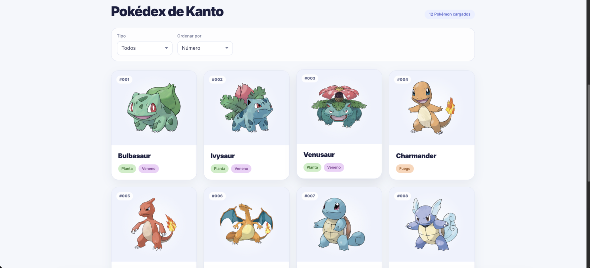
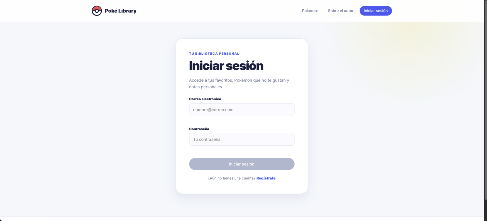
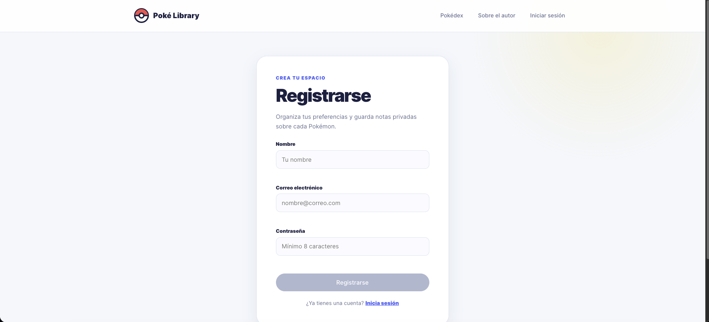
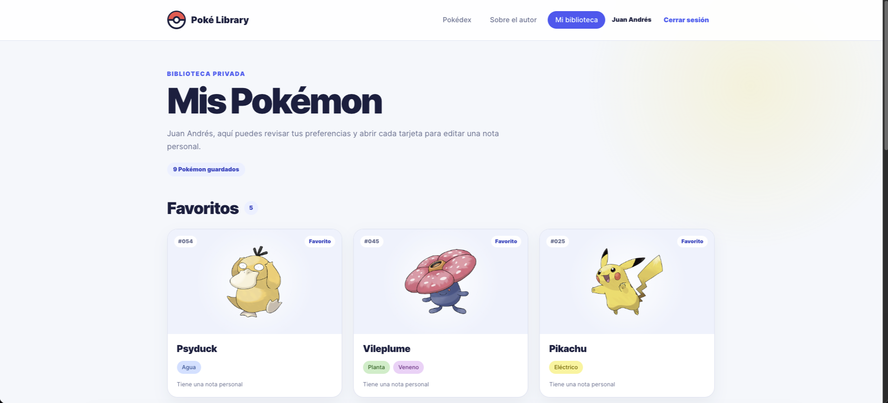
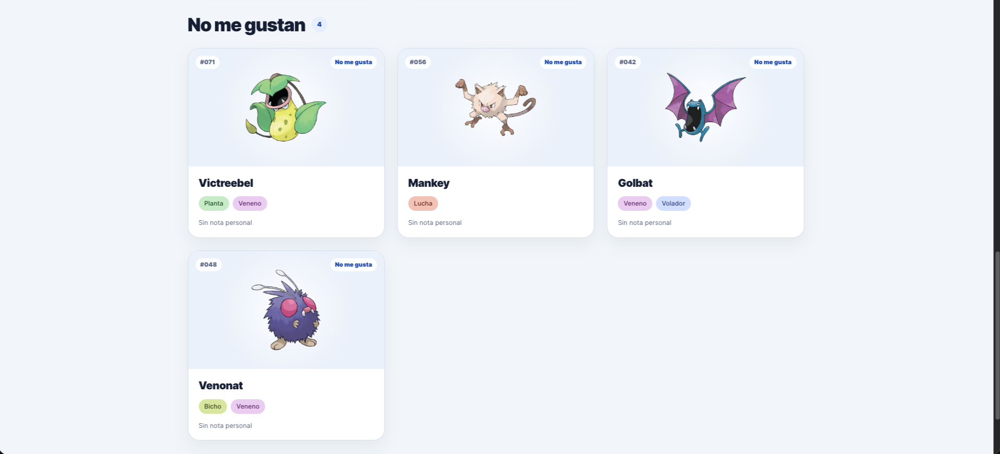
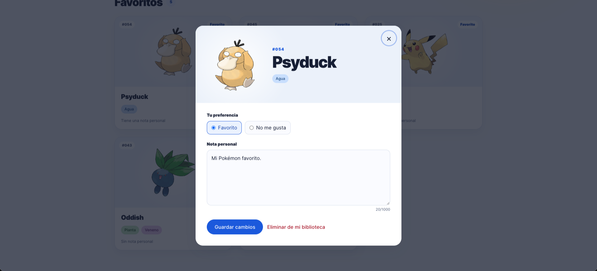
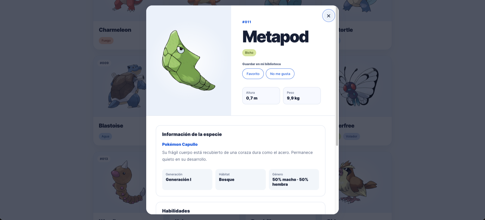

# Poké Library Client

Interfaz web de Poké Library construida con React, TypeScript y Vite. Permite
explorar los 151 Pokémon de Kanto y, mediante una cuenta, mantener una
biblioteca privada con preferencias y notas personales.

## Despliegue

- [Aplicación web](https://project-poke-library-client.vercel.app)
- [API REST](https://project-poke-library-server.vercel.app)

El cliente está desplegado en Vercel como una aplicación de página única. Las
rutas de React Router se redirigen a `index.html` mediante `vercel.json`.

## Funcionalidades

### Pokédex pública

- Catálogo de los Pokémon de Kanto con carga incremental.
- Búsqueda por nombre o número.
- Filtros por los 17 tipos presentes en la primera generación.
- Orden por número o nombre.
- Detalle con altura, peso, habilidades, estadísticas e información de especie.
- Contenido de PokéAPI priorizado en español, con inglés como respaldo.

### Autenticación y biblioteca privada

- Registro, inicio y cierre de sesión.
- Restauración de la sesión mediante un JWT almacenado en `localStorage`.
- Ruta protegida `/mypokemon`.
- Guardado de Pokémon como favoritos o como «No me gusta».
- Cambio de preferencia y notas personales desde el detalle privado.
- Eliminación mediante un botón circular con papelera en cada tarjeta o desde
  su detalle, usando el mismo popup de confirmación en ambos casos.
- Scroll interno en los detalles públicos y privados para conservar el acceso a
  todas las acciones en pantallas bajas o con zoom aumentado.
- Estados de carga, validación, error y resultados vacíos.

## Tecnologías

- React 19 y React Router.
- TypeScript.
- Vite.
- CSS con metodología BEM.
- Fetch API para PokéAPI y la API propia.

## Variables de entorno

Copia el archivo de ejemplo y configura la URL de la API:

```bash
cp .env.example .env
```

Para desarrollo local:

```env
VITE_API_URL=http://localhost:3001
```

En Vercel, `VITE_API_URL` utiliza
`https://project-poke-library-server.vercel.app`. Las variables con prefijo
`VITE_` se incorporan al bundle del navegador y no deben contener secretos.

## Instalación y comandos

```bash
npm install
npm run dev
npm run lint
npm run build
npm run preview
```

El servidor de desarrollo se ejecuta en `http://localhost:3000`.

## Estructura principal

```text
src/
├── blocks/       # Estilos BEM
├── components/   # Páginas y componentes reutilizables
├── contexts/     # Usuario autenticado
├── hooks/        # Validación de formularios
├── interfaces/   # Tipos de PokéAPI, autenticación y biblioteca
└── utils/        # API propia, PokéAPI, mapeadores y validaciones
```

## Capturas

Todas las capturas conservan una proporción uniforme de `11:5`.

| Inicio | Catálogo de Kanto |
| --- | --- |
|  |  |

| Inicio de sesión | Registro |
| --- | --- |
|  |  |

| Pokémon favoritos | Pokémon marcados como «No me gusta» |
| --- | --- |
|  |  |

| Edición de preferencia y nota | Detalle público de un Pokémon |
| --- | --- |
|  |  |
