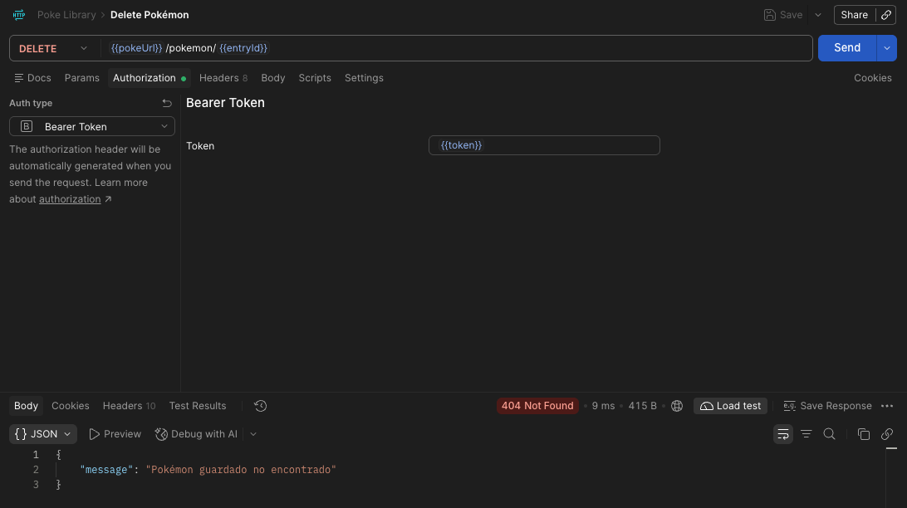

# Poké Library API

API REST de Poké Library construida con Express, TypeScript, MongoDB y
Mongoose. Gestiona la autenticación y la biblioteca privada de cada usuario.

## Despliegue

- [API en Vercel](https://project-poke-library-server.vercel.app)
- [Estado del servicio](https://project-poke-library-server.vercel.app/health)
- [Frontend de Poké Library](https://project-poke-library-client.vercel.app)

La API se ejecuta en Vercel y persiste los datos en MongoDB Atlas.

## Funcionalidades

- Registro con correo único, nombre y contraseña protegida mediante bcrypt.
- Inicio de sesión con JWT válido durante siete días.
- Middleware de autorización para todas las rutas privadas.
- Perfil privado con correo y nombre.
- Pokémon favoritos y no favoritos filtrados por propietario.
- Notas personales y cambio de preferencia para cada Pokémon guardado.
- Comprobación de propiedad antes de actualizar o eliminar registros.
- CORS configurable para uno o varios dominios del cliente.
- Límites generales y límites específicos para registro e inicio de sesión.
- Validación de controladores, esquemas de Mongoose y errores centralizados.
- Rutas públicas de registro e inicio de sesión agrupadas en un router de
  autenticación y montadas antes del middleware que protege la API privada.

## Variables de entorno

Copia `.env.example` como `.env` y reemplaza sus valores:

```env
JWT_SECRET=una-clave-aleatoria-segura
MONGO_URI=mongodb://localhost:27017/poke_library
PORT=3001
CLIENT_ORIGIN=http://localhost:3000
```

En producción, `MONGO_URI` debe apuntar a MongoDB Atlas y `CLIENT_ORIGIN` al
dominio público del frontend, actualmente
`https://project-poke-library-client.vercel.app`. Se pueden permitir varios
orígenes separándolos por comas.

## Instalación y ejecución

```bash
npm install
npm run dev
```

Para compilar, iniciar la versión generada y ejecutar ESLint:

```bash
npm run build
npm run start
npm run lint
```

## Rutas públicas

| Método | Ruta | Descripción |
| --- | --- | --- |
| `GET` | `/health` | Devuelve el estado del servicio. |
| `POST` | `/signup` | Registra una cuenta. |
| `POST` | `/signin` | Devuelve un JWT y el perfil autenticado. |

## Rutas protegidas

Todas requieren `Authorization: Bearer <token>`.

| Método | Ruta | Descripción |
| --- | --- | --- |
| `GET` | `/users/me` | Devuelve el correo y nombre propios. |
| `GET` | `/pokemon` | Devuelve todos los Pokémon guardados propios. |
| `GET` | `/pokemon?preference=favorite` | Filtra favoritos o no favoritos. |
| `POST` | `/pokemon` | Guarda un Pokémon con preferencia y nota. |
| `PATCH` | `/pokemon/:id` | Cambia la preferencia o la nota. |
| `DELETE` | `/pokemon/:id` | Elimina un registro propio. |

El cuerpo de creación de un Pokémon tiene esta forma:

```json
{
  "pokemonId": 25,
  "pokemonName": "Pikachu",
  "imageUrl": "https://example.com/pikachu.png",
  "types": ["electric"],
  "preference": "favorite",
  "note": "Mi Pokémon favorito desde la primera generación."
}
```

`preference` acepta únicamente `favorite` o `disliked`. Un usuario no puede
guardar dos veces el mismo `pokemonId`, pero puede moverlo entre listas con la
ruta `PATCH`.

## Límite de búsqueda de PokéAPI

La aplicación desplegada consume la instancia pública de PokéAPI. En esa
instancia, `/api/v2/pokemon/{id-or-name}` requiere el identificador o el nombre
completo del Pokémon, mientras que el listado público solo admite paginación
mediante `limit` y `offset`.

La especificación de PokéAPI incluye un parámetro `q` para búsquedas parciales,
pero aclara que está disponible únicamente al ejecutar la API localmente y no
en `pokeapi.co`. Por esa razón, una búsqueda como `pika` no puede resolverse en
el despliegue online sin añadir un índice o filtrado propio, funcionalidad que
intencionalmente no forma parte de este proyecto.

- [Documentación oficial de PokéAPI](https://pokeapi.co/docs/v2)
- [Especificación del listado y parámetro `q`](https://pokeapi.co/v2/openapi/operations/pokemon_list)

## Respuestas de error

La API devuelve los errores con un único campo `message`:

| Estado | Uso |
| --- | --- |
| `400` | Datos ausentes, inválidos o que no pasan el esquema. |
| `401` | Credenciales o token incorrectos. |
| `403` | Origen no permitido o intento de modificar datos ajenos. |
| `404` | Recurso inexistente. |
| `409` | Correo o Pokémon duplicado. |
| `429` | Límite de solicitudes superado. |
| `500` | Error inesperado ocultado al cliente. |

## Evidencias visuales en Postman

Las siguientes capturas corresponden a pruebas locales de la API. Los tokens,
identificadores, usuarios y datos mostrados pertenecen únicamente al entorno de
pruebas.

### Estado, registro y autenticación

<details>
<summary><code>GET /health</code> — servicio disponible (200)</summary>


</details>

<details>
<summary><code>POST /signup</code> — registro de usuario (201)</summary>


</details>

<details>
<summary><code>POST /signup</code> — correo ya registrado (409)</summary>


</details>

<details>
<summary><code>POST /signin</code> — inicio de sesión y entrega de JWT (200)</summary>


</details>

<details>
<summary><code>GET /users/me</code> — perfil autenticado (200)</summary>


</details>

### Biblioteca privada de Pokémon

<details>
<summary><code>POST /pokemon</code> — guardar como favorito (201)</summary>


</details>

<details>
<summary><code>POST /pokemon</code> — guardar como no favorito (201)</summary>


</details>

<details>
<summary><code>GET /pokemon</code> — listar la biblioteca propia (200)</summary>


</details>

<details>
<summary><code>GET /pokemon?preference=favorite</code> — filtrar favoritos (200)</summary>


</details>

<details>
<summary><code>GET /pokemon?preference=disliked</code> — filtrar no favoritos (200)</summary>


</details>

<details>
<summary><code>PATCH /pokemon/:id</code> — editar una nota (200)</summary>


</details>

<details>
<summary><code>PATCH /pokemon/:id</code> — cambiar la preferencia (200)</summary>


</details>

<details>
<summary><code>DELETE /pokemon/:id</code> — eliminar un registro propio (200)</summary>


</details>

### Seguridad y errores

<details>
<summary><code>DELETE /pokemon/:id</code> — intento de eliminar un registro ajeno (403)</summary>


</details>

<details>
<summary>Ruta inexistente autenticada — recurso no encontrado (404)</summary>



</details>

